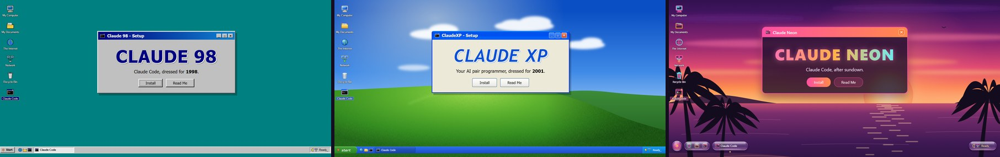

<p align="center">
  
</p>

<h1 align="center">🕰️ ClaudeEras</h1>

<p align="center"><strong>FOUR DESKTOP ERAS, ONE MOD.</strong></p>

**ClaudeEras** combines [Claude 98](https://github.com/weihaoc168/Claude98), [ClaudeXP](https://github.com/weihaoc168/ClaudeXP) and Claude Neon into one Claude Code mod with a style switch, plus an original cyberpunk-genre style, Claude Blade. Each style brings its own wallpaper, icons, taskbar, window chrome and color schemes:

| Style | Desktop | Windows |
| --- | --- | --- |
| **Windows 98** | Classic plain teal, pixel icons, grey taskbar and Start button | Square silver windows, black frames |
| **XP** | A rolling green meadow, glossy icons, blue taskbar with a green start button | Cream windows, rounded blue frames, red close box |
| **Claude Neon** | A softly realistic pink, purple and orange sunset over the sea with palms, neon retro icons, a floating liquid-glass taskbar | Night-purple windows, hot-pink frames |
| **Claude Blade** | An original rainy neon-noir megacity at night: hazy towers, lit windows, made-up neon signs, a glitching hologram billboard, light trails and a wet street, under scanlines Also **Overlook**, an original pixel-art night scene: a hillside above a neon city with a moon, a rocket launch, hover drones and a neon bike. | Square near-black HUD windows with cyan frames, acid-yellow buttons, a red close box |

## ⚡ Install

```bash
claude plugin install claudeeras --marketplace weihaoc168/ClaudeEras
```

At the prompt of a terminal session: `/plugin install claudeeras --marketplace weihaoc168/ClaudeEras`. In the desktop app: click **+** next to the prompt box → **Plugins** → **Add marketplace** with `weihaoc168/ClaudeEras` → **Add plugin**.

Use it instead of the single-style mods, not alongside them: uninstall `claude98`, `claudexp` or `claudeneon` first.

## 🎛️ Switching styles

- **Display Properties** (`/display`) → **Background** → **Style**, then **OK** or **Apply**. The preview shows the style before you apply it.
- Or type `/style` to step through Windows 98 → XP → Claude Neon → Claude Blade.

Switching a style resets the wallpaper to that style's own default; your scheme and effects carry over.

**Your own image (Claude Blade).** Put a small picture of your own at `custom/wallpaper.png` (or `custom/wallpaper.jpg`) in the mod's folder, then pick **Your own image** under Claude Blade's wallpapers. It is built into the drawn scene, so the desktop icons, taskbar and glass sit over it, and pixel art keeps crisp pixels. A scene has a size cap, so keep the file under about 80 KB: for pixel art, save it at its true pixel size (around 500-600 px wide) as a PNG with a limited palette. The `custom/` folder is git-ignored, so the picture stays on your computer. Use only pictures you have the right to use.

## ⌨️ Commands

| Command | What it does |
| --- | --- |
| `/display` | Display Properties: style, wallpaper, scheme, effects |
| `/style` | Switches to the next style |
| `/sysmon` | System Monitor |
| `/startmenu` | The Start menu |
| `/startband` | Shows or hides the Start band above the prompt |
| `/eras-check` | The current style, which screens the session draws on, and whether the theme reached them |

---

<p align="center"><sub>An original tribute. Not affiliated with or endorsed by Microsoft or any game publisher; no game art, names or locations are used, and all art is drawn from scratch.</sub></p>
